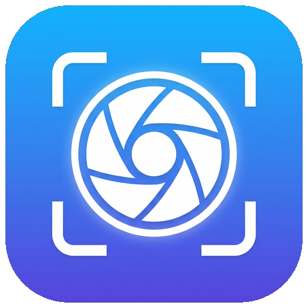

# prinSkrin

Лёгкий скриншотер для **Windows 10** в духе Lightshot: висит в трее, на **PrtSc** показывает
поверх экрана мини-панель, где видно, *что именно* сохранять — выделенную область, весь экран,
конкретное окно или отдельный монитор. Всё сохраняется в выбранную папку.



## Что умеет

- **PrtSc** (или своя горячая клавиша) — поверх экрана появляется мини-панель.
- Режимы захвата:
  - **Выделение** — рамка мышью с изменением размера за уголки (режим по умолчанию);
  - **Весь экран** — мгновенный снимок активного монитора;
  - **Окно** — наводите курсор, окно подсвечивается, клик = снимок этого окна;
  - **Дисплей** — отдельная кнопка на каждый монитор (если их несколько).
- Мини-редактор прямо на оверлее: карандаш, маркер, прямоугольник, стрелка,
  текст, 8 цветов, 3 толщины, отмена (Ctrl+Z).
- Готовый скриншот: **Сохранить** (Enter), **Копировать** (Ctrl+C), **Ещё…** — «Сохранить как…».
- Автосохранение в папку по шаблону имени (по умолчанию `Pictures\prinSkrin`),
  формат PNG или JPEG с настраиваемым качеством.
- Копирование в буфер обмена и уведомление — включаются/выключаются.
- Живёт в трее, умеет запускаться вместе с Windows.
- Настройки открываются **при первом запуске** и **при обычном запуске ярлыком**
  (повторный запуск просто показывает окно настроек, второй экземпляр не создаётся).

## Управление в оверлее

| Действие | Клавиша / мышь |
| --- | --- |
| Выделить область | зажать ЛКМ и тянуть |
| Переместить / изменить рамку | тянуть внутри / за уголки |
| Весь экран | `Space` или кнопка |
| Сохранить в папку | `Enter` |
| Сохранить как… | `Ctrl+S` |
| Копировать в буфер | `Ctrl+C` |
| Отменить последний элемент | `Ctrl+Z` |
| Сбросить выделение | `Delete` / `Backspace` / ПКМ |
| Закрыть оверлей | `Esc` |

## Готовый .exe

В разделе **Actions → Build Windows app** собираются два файла:

- `prinSkrin-Setup-1.0.0.exe` — установщик (создаёт ярлыки на рабочем столе и в меню «Пуск»);
- `prinSkrin-1.0.0-portable.exe` — портативная версия, один файл, без установки.

Установщик не требует прав администратора (ставится в профиль пользователя).

## Сборка своими руками

На Windows 10 с установленным [Node.js 20+](https://nodejs.org):

```bat
git clone https://github.com/BaraAoi/prinSkrin.git
cd prinSkrin
npm install
npm run dist:win
```

Готовые файлы появятся в папке `release`.

Портативная папка без установщика:

```bat
npm run pack:win
:: release\prinSkrin-win32-x64\prinSkrin.exe
```

Запуск из исходников (для разработки):

```bat
npm start            :: запуск с окном настроек
npm start:capture    :: сразу режим скриншота
```

## Как это устроено

```
src/
  main/                — процесс Electron
    main.js            — точка входа, одиночный экземпляр, горячая клавиша, IPC
    capture.js         — снимок экранов (desktopCapturer) + оверлеи на каждый монитор
    windowList.js      — список окон Windows через PowerShell + user32/dwmapi
    saver.js           — имена файлов, PNG/JPEG, буфер обмена, уведомления
    store.js           — настройки в %APPDATA%\prinSkrin\settings.json
    settingsWindow.js  — окно настроек
    tray.js            — иконка и меню в трее
  preload/             — мосты contextBridge (contextIsolation, без nodeIntegration)
  renderer/
    overlay/           — оверлей: выделение, подсветка окон, мини-редактор
    settings/          — интерфейс настроек
```

Скриншот делается **до** появления оверлея, поэтому панель и затемнение
никогда не попадают в сам снимок.

## Заметки по Windows

- Если на Windows включено «Использовать клавишу PrtSc для Snipping Tool» (Параметры →
  Специальные возможности → Клавиатура), система может перехватывать PrtSc раньше
  приложения. В настройках prinSkrin выберите другое сочетание (например `Ctrl+PrtSc` или `F8`).
- При нескольких мониторах с разным масштабом (DPI) подсветка окон в режиме «Окно»
  может смещаться на несколько пикселей — снимок при этом делается корректно.
- Данные настроек: `%APPDATA%\prinSkrin\settings.json`,
  по умолчанию скриншоты: `C:\Users\<вы>\Pictures\prinSkrin`.

## Лицензия

MIT
